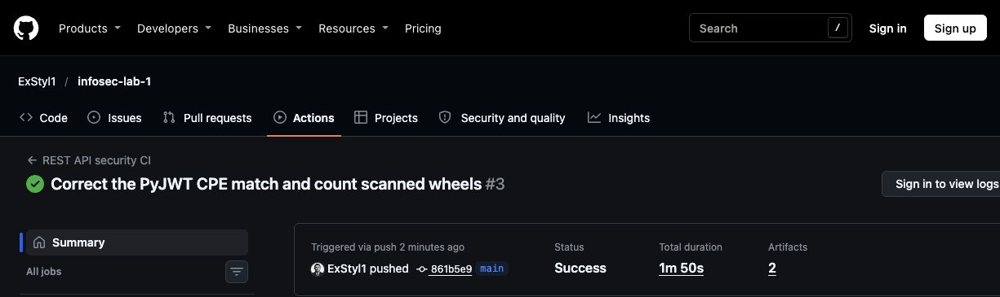
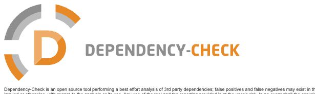
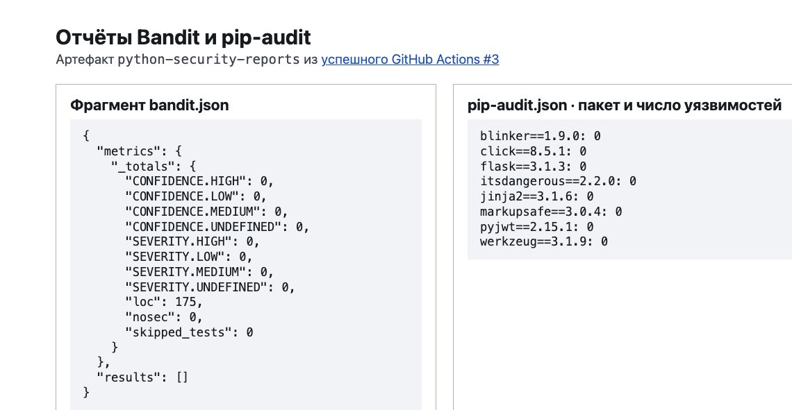

# Информационная безопасность. Лабораторная работа № 1

Защищённый REST API с регистрацией, входом и выдачей учебных данных по JWT.

## Стек

- Python 3.12, Flask, SQLite, Werkzeug, MarkupSafe и PyJWT.
- GitHub Actions, Bandit, OWASP Dependency-Check и pip-audit.

## Запуск

```bash
python3.12 -m venv .venv
source .venv/bin/activate
python -m pip install --require-hashes -r requirements.txt
JWT_SECRET="$(python -c 'import secrets; print(secrets.token_hex(32))')"
export JWT_SECRET
python -m flask --app secure_api run --host 127.0.0.1 --port 5000
```

SQLite создаётся при запуске в `instance/api.sqlite3`. Файл можно переопределить переменной `DATABASE_PATH`. Ключ JWT берётся из окружения. Смена ключа делает ранее выданные токены недействительными. Flask development server используется для локальной демонстрации. При развёртывании аутентификационные данные следует передавать по HTTPS.

## Описание API

| Метод | Назначение | Результат |
| --- | --- | --- |
| `POST /auth/register` | Принимает JSON с `login` и `password`, создаёт запись. | `201 Created`, `400 Bad Request` при некорректном вводе, `409 Conflict` при повторе логина. |
| `POST /auth/login` | Принимает те же поля и при верном пароле выдаёт `access_token`. | `200 OK` или `401 Unauthorized` для неверных учётных данных. |
| `GET /api/data` | Возвращает данные демонстрационного каталога и профиль текущего пользователя. | `200 OK` с JWT, `401 Unauthorized` без действительного JWT. |

Логин содержит от 3 до 64 печатных символов без крайних пробелов. Пароль содержит от 12 до 128 символов. Допустимый размер тела запроса — 8 КБ.

### Пример вызовов

```bash
BASE=http://127.0.0.1:5000
DATA='{"login":"demo-student","password":"demo-only-long-passphrase"}'
JSON='Content-Type: application/json'

curl -i "$BASE/auth/register" -H "$JSON" -d "$DATA"
LOGIN="$(curl -fsS "$BASE/auth/login" -H "$JSON" -d "$DATA")"
TOKEN="$(printf '%s' "$LOGIN" | python -c \
  'import json, sys; print(json.load(sys.stdin)["access_token"])')"
curl -i "$BASE/api/data"
curl -i "$BASE/api/data" -H "Authorization: Bearer $TOKEN"
```

## Реализованные меры защиты

**SQL-инъекции.** Запросы SQLite используют параметры `?`. Переданный логин и идентификатор пользователя передаются отдельно от текста SQL. Уникальность логина контролируется ограничением базы.

**XSS.** Значение `login` экранируется через `MarkupSafe.escape` при построении ответа. В SQLite хранится исходное значение логина. Ответы имеют тип `application/json`, заголовок `X-Content-Type-Options: nosniff` и ограничительную `Content-Security-Policy`.

**Аутентификация.** Пароли хешируются с `scrypt:32768:8:3` и случайной солью. При успешном входе сервер выдаёт JWT на 15 минут. Перед обработкой маршрутов `/api` middleware проверяет подпись JWT по фиксированному алгоритму HS256, обязательные поля `sub`, `iss`, `aud`, `iat`, `exp`, издателя, получателя и срок действия токена. Проверяется существование пользователя. Ответ `401` при неверном логине или пароле одинаковый. Ответы API сопровождаются `Cache-Control: no-store`.

### Фрагменты реализации

```python
user = get_db().execute(
    "SELECT id, password_hash FROM users WHERE login = ?", (username,)
).fetchone()

def public_user(user_id, login):
    return {"id": user_id, "login": str(escape(login))}
```

## Проверки и отчёты CI

```bash
python -m unittest discover -s tests -v
python -m scripts.http_smoke
```

Проверка curl подтвердила статусы 201 при регистрации, 200 при входе, 401 для защищённого ресурса без JWT и 200 с действительным JWT.

Workflow запускается при `push` и `pull_request`. Он выполняет тесты, проверяет HTTP-ответы через curl, анализирует Python-код через Bandit, сверяет зафиксированные пакеты с PyPI через pip-audit и сканирует wheel-файлы через OWASP Dependency-Check. OWASP Dependency-Check использует зеркало NVD проекта, HTML- и JSON-отчёты сохраняются в артефактах. Порог блокировки OWASP Dependency-Check — CVSS 7. Для Bandit и pip-audit ненулевой код завершения помечает проверку как неуспешную.

При первом анализе коллизия имён связала wheel PyJWT 2.15.1 с CVE-2025-45770. По записи OSV уязвимый компонент — PHP-проект `lcobucci/jwt`. В конфигурации исключена только эта пара пакета и CVE. Остальные совпадения проверяются в обычном режиме. [Запись OSV](https://osv.dev/vulnerability/CVE-2025-45770)

[Запуски GitHub Actions](https://github.com/ExStyl1/infosec-lab-1/actions/workflows/ci.yml)

## Скриншоты GitHub Actions

В [успешном прогоне № 3](https://github.com/ExStyl1/infosec-lab-1/actions/runs/44344724448) прошли 6 тестов и проверка через curl. Bandit проанализировал 175 строк и не выдал замечаний. pip-audit и OWASP Dependency-Check проверили 8 пакетов. По итогам обеих проверок подтверждённых уязвимостей нет.






